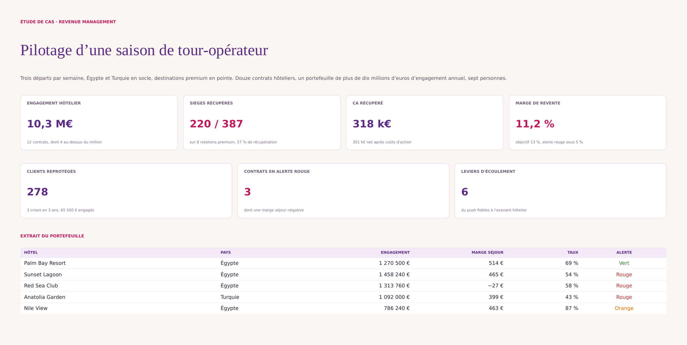

# Pilotage de saison — production touristique

Un classeur Excel de pilotage pour une saison de tour-opérateur, construit à partir de mon expérience réelle chez **Partir Pas Cher (Switch PPC France)** : production interne, achat des hôtels et des places d'avion, revenue management, gestion de crise. Destinations phares : République dominicaine, Costa Rica, Thaïlande, Dubaï.

L'objectif n'était pas de faire joli : c'était de savoir, chaque lundi, quelles places allaient rester invendues, quels contrats hôteliers coûtaient trop cher, et quelle action déclencher avant qu'il ne soit trop tard.

## Les quatre chiffres

| Indicateur | Valeur |
|---|---|
| Engagement hôtelier annuel | 10,3 M€ sur 12 contrats, dont 4 au-dessus du million |
| Sièges invendus récupérés | 220 sur 387, soit 57 % |
| CA récupéré sur ces rotations | 318 k€, 301 k€ net |
| Clients reprotégés en 3 crises | 278, pour 65 500 € engagés |

## Ce que contient le classeur

Onze onglets, un par question de pilotage :

- **Lecture** — le contexte et ce que le fichier remplace.
- **Rétroplanning** — 12 étapes de la négociation au bilan, Gantt sur 30 semaines, fin d'étape calculée par WORKDAY.
- **Départs** — sièges achetés et vendus, prix moyen, coût, marge, sièges restants.
- **Contrats hôtels** — 12 hôtels, chambres par départ, départs par an, engagement annuel, marge séjour, alerte et action.
- **Cellule invendus** — le cœur du sujet : chaque rotation, son action, son horizon, son coût, son CA récupéré, sa marge de revente. Avec le catalogue des six leviers.
- **Rotations & legs** — optimisation des legs aller-retour.
- **Ventes** — trois canaux consolidés par Power Query.
- **Budget** — 7 postes, engagé, facturé, disponible, alerte à 90 %.
- **Risques** — surbooking, release dates, annulation de vol, défaillance hôtelière.
- **Incidents** — registre de crise : reprotections, coût, délai, suites juridiques.
- **Tableau de bord** et **Revue DAF** — les indicateurs et le point hebdomadaire avec la direction financière.

## La logique, en trois règles

1. **Engagement d'un contrat** : chambres par départ × départs par an × nuits × coût de la chambre.
2. **Alerte hôtel** : rouge si la marge séjour est négative ou si une garantie ferme passe sous 60 % de taux ; orange au-dessus de 85 %.
3. **Marge de revente** : on visait plus de 13 %. Sous 5 %, alerte rouge et action le jour même.

## Comment l'ouvrir

Télécharger le fichier `Pilotage-de-saison-production-touristique.xlsx` et l'ouvrir dans Excel, LibreOffice ou Google Sheets. Les formules sont conservées, les onglets figés et colorés.

## Aller plus loin

L'étude de cas complète — contexte, organisation, méthode, résultats, ce que ça démontre — est dans [ETUDE-DE-CAS.md](ETUDE-DE-CAS.md).

## Auteure

**Fahima Behillil** — chargée de projet IA & automatisation
[LinkedIn](https://linkedin.com/in/fahima-be) · [GitHub](https://github.com/Fahima94) · horizonsdatas@gmail.com

> Les données du classeur sont des données de démonstration, calibrées sur les volumes réels d'une saison. Aucun nom de client, aucun tarif confidentiel n'y figure.
